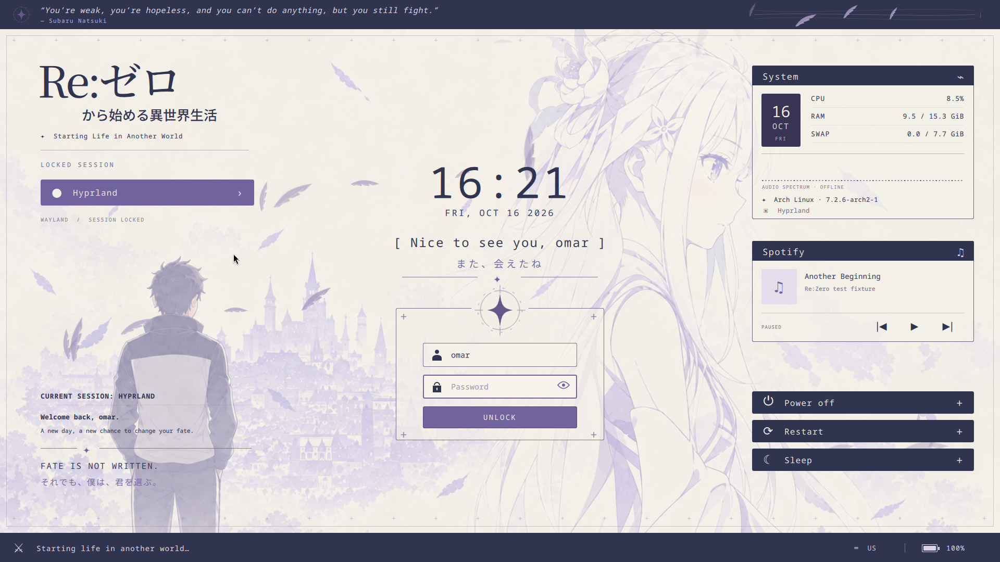

# Re:Zero — Another Beginning · QuickShell lock screen

An installable **Wayland lock screen for Hyprland**, preserving the ivory and lavender Re:Zero design. QuickShell provides real session locking and PAM authentication. Unlock with your existing Linux password.



Captured from the installed locker in nested Hyprland. Spotify metadata in this capture comes from the MPRIS test service. [Without Spotify](docs/quickshell-no-spotify.png).

- Original three-column layout, artwork, clock, account form, system statistics, and power confirmations.
- Drifting feathers and the wind ribbon; the character artwork stays still. The hair distortion shader has been removed.
- A quiet **Spotify** panel with cover art, track/artist, previous, play/pause, and next. It appears only when the Spotify desktop app exposes a controllable MPRIS player. Unsupported controls are disabled. No API key or Spotify login is stored by the theme.
- The session note follows the reference: `CURRENT SESSION: HYPRLAND`, a personal greeting, a fine star divider, and the two fate lines on the wallpaper.
- Super + L, optional five-minute idle locking, and locking before suspend through Hypridle. Every monitor receives a lock surface, including monitors connected while locked.

The session label names the desktop you are resuming. It is not a login-manager session chooser.

## Install on Arch Linux

Run these commands on the computer that will use the lock screen, inside an existing Hyprland desktop. Install current distribution packages together; QuickShell and Qt must have compatible versions.

```sh
sudo pacman -S --needed git python quickshell qt6-svg hypridle util-linux glib2 \
  ttf-jetbrains-mono noto-fonts-cjk

git clone https://github.com/MrTr4p/rezero-hyprlock.git
cd rezero-hyprlock
python3 install.py --enable
```

Optional real audio spectrum: install `cava`. Without it, the spectrum is marked offline; Spotify controls work independently. Use Spotify's Linux desktop app for the Spotify panel. A browser tab alone does not expose the desktop Spotify MPRIS identity and does not activate this panel.

The installer copies all runtime files, backs up files it replaces, and adds a managed include block to your Hyprland configuration. It automatically uses **`hyprland.lua` when present**, otherwise `hyprland.conf`. Lua uses `dofile(...)`, `hl.bind(...)`, and a `hyprland.start` callback for the idle daemon. If both files exist, Lua takes precedence; use `--hyprland-format conf` to select the older format explicitly.

To select Lua explicitly:

```sh
python3 install.py --enable --hyprland-format lua
```

It does not start a locker or reload the desktop. **Log out and back in** when ready so Hyprland starts the supplied idle daemon at login. Then:

```sh
~/.local/bin/rezero-lock
```

Unlock with your Linux password. Enter submits; Escape clears input. Check Super + L, `loginctl lock-session`, inactivity, and an actual suspend/resume cycle on that machine. The theme uses the distribution's existing `/etc/pam.d/login` authentication policy; it does not install or weaken PAM rules.

Already have **Hypridle, Swayidle, a dotfile suite, or another lock shortcut**? Use:

```sh
python3 install.py --enable --no-idle
```

Then point your existing lock commands to `~/.local/bin/rezero-lock`. For Hypridle, update the existing blocks, preserving your other settings:

```ini
general {
    lock_cmd = ~/.local/bin/rezero-lock
    before_sleep_cmd = ~/.local/bin/rezero-lock
    after_sleep_cmd = hyprctl dispatch dpms on
    inhibit_sleep = 3
}
listener {
    timeout = 300
    on-timeout = ~/.local/bin/rezero-lock
}
```

Run one idle daemon. The installer checks both `.lua` and `.conf` files for existing idle startup commands and refuses automatic idle integration if it detects an existing setup or active/enabled `hypridle.service`. The generated binding replaces Super + L.

For symlinked or managed dotfiles, install without `--enable`, then add the printed include line to your own configuration. Both snippets are generated. For Lua, use the actual installed path, or this equivalent default-path include:

```lua
dofile(os.getenv("HOME") .. "/.config/hypr/rezero/hyprland.lua")
```

For `.conf`, use `source = ~/.config/hypr/rezero/hyprland.conf`. Add `--no-idle` to the installation command if your setup already starts an idle daemon. Custom `XDG_CONFIG_HOME` paths are reflected in the installer's printed include line.

## Customize, update, or uninstall

Edit `~/.config/quickshell/rezero/Settings.qml`:

```qml
property bool animations: true                 // false for reduced motion
property string background: "assets/background.png"
property string pamService: "login"            // existing system PAM policy
```

Alternate backgrounds: `assets/royal-capital.png` and `assets/moonlit-forest.png`. There is no hair sway option. CPU/RAM/swap, keyboard layout, Caps Lock, and battery come from local system data. Power buttons are enabled only when logind allows the action without another authentication dialog; confirmation runs the real system action.

Runtime files live in `~/.config/quickshell/rezero/`; idle and Hyprland snippets live in `~/.config/hypr/rezero/`. Launchers live in `~/.local/bin/`. The checkout can be moved or removed after installation. `XDG_CONFIG_HOME`, `XDG_DATA_HOME`, and `XDG_STATE_HOME` are respected. No browser, HTTP server, compiler, or demo password is involved in the installed locker.

To update, pull and rerun your original installation flags:

```sh
git pull --ff-only
python3 install.py --enable
```

Updates back up edited managed files before replacing them. Reapply your settings from `~/.local/state/rezero-hyprlock/preserved/` afterward. Original copies remain in `originals/`. Update while the screen is unlocked, because QuickShell can reload configuration changes.

To uninstall while unlocked:

```sh
python3 install.py --uninstall
```

This restores replaced files and removes the managed Hyprland source block while preserving unrelated edits. Log out and back in to stop using the managed idle daemon. Manual integrations need to be removed manually. Dependencies and backups are retained.

If the locker cannot authenticate, switch to a TTY with Ctrl + Alt + F3 and inspect the selected PAM policy. QuickShell's session-lock protocol keeps the session locked if the locker crashes; killing the locker is not an unlock method. To recover its UI on Hyprland, enable `misc:allow_session_lock_restore` in your own configuration and rerun the launcher from a TTY with your graphical session's environment, or end the affected graphical session. Do not use passwordless PAM rules as a workaround.

## Static Hyprlock fallback and development

The optional [static Hyprlock installation](docs/hyprlock-install.md) remains available with `python3 install.py --backend hyprlock --enable`. It uses a simpler static layout without feathers or media controls.

The previous browser demo is archived under [`localhost/`](localhost/README.md); it is not the installed locker. The QuickShell version above is the supported installation.

[Validation details](docs/validation.md) cover real nested Hyprland/PAM, MPRIS controls, multi-monitor coverage, idle locking, and simulated sleep integration. To reproduce on a Wayland desktop with the developer dependencies installed:

```sh
python3 -m unittest discover -s tests -v
python3 tests/quickshell_smoke.py
```

Unofficial Re:Zero fan theme adapted from [MrTr4p/rezero-sddm](https://github.com/MrTr4p/rezero-sddm). [Artwork provenance](docs/artwork.md).

Backend references: [QuickShell session locking](https://quickshell.org/docs/v0.3.1/types/Quickshell.Wayland/WlSessionLock/), [PAM authentication](https://quickshell.org/docs/v0.3.1/types/Quickshell.Services.Pam/PamContext/), and [MPRIS player controls](https://quickshell.org/docs/v0.3.1/types/Quickshell.Services.Mpris/MprisPlayer/). Hyprland Lua references: [key bindings](https://wiki.hypr.land/configuring/core/binds/) and [autostart](https://wiki.hypr.land/configuring/core/autostart/).
