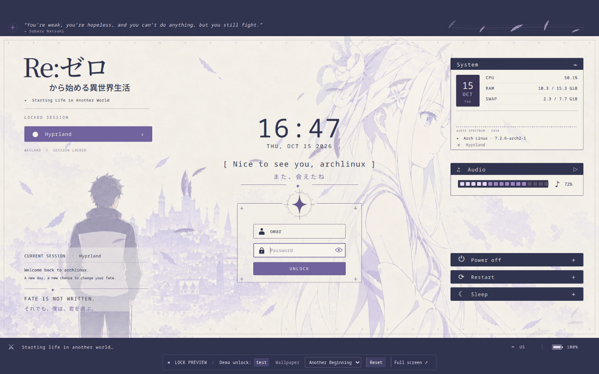

# Re:Zero — Another Beginning · Lock-screen preview

The full Re:Zero interface as an interactive **localhost preview**: animated hair and feathers, wind ribbon, session/account panels, CPU/RAM/swap statistics, CAVA spectrum, ambience controls, battery/layout footer, and power dialogs. The central action is **Unlock**.



This version previews the complete design in your browser. Unlock and power actions are simulated; it does not install or activate a system locker. Use the demo password **`test`**, not your real password.

## Install and run the full preview on Arch Linux

Run these steps on the computer where you want to view the preview. Use your normal desktop account; only the package installation uses `sudo`. A graphical Linux session with a working systemd user session is required.

### 1. Install dependencies

On an up-to-date Arch Linux installation:

```sh
sudo pacman -S --needed base-devel git python qt6-base qt6-declarative \
  qt6-multimedia qt6-svg qt6-shadertools mesa xorg-server-xvfb x11vnc \
  cava ttf-jetbrains-mono noto-fonts-cjk
```

Other distributions need equivalent Qt 6, Xvfb, x11vnc, CAVA, compiler, and Python packages. SDDM, Hyprlock, Sway, and Quickshell are not needed for the browser preview.

### 2. Download the project

Run these commands from the directory where you keep your projects:

```sh
git clone https://github.com/MrTr4p/rezero-hyprlock.git
cd rezero-hyprlock
```

If you already cloned it, enter the checkout and run `git pull --ff-only` instead.

### 3. Set up the preview's Python environment

```sh
python3 -m venv "$HOME/.local/share/rezero-lock-preview/venv"
"$HOME/.local/share/rezero-lock-preview/venv/bin/pip" install -r localhost/preview/requirements.txt
```

This keeps the WebSocket bridge's Python dependencies in their own environment. You do not need to activate it; the launcher finds it automatically.

### 4. Start and open the preview

```sh
./localhost/start.sh
```

Open **[http://localhost:8772/](http://localhost:8772/)** on the same computer. The first launch compiles the small Qt preview program. Type **`test`** and press Enter or click Unlock. An incorrect nonempty password demonstrates the error state; successful demo unlock resets after a short pause.

The bottom toolbar switches between three wallpapers, resets the scene, and opens full screen. Audio starts paused. The power buttons open confirmation dialogs, but never power off, restart, or suspend the computer.

### 5. Stop or start it again

From the repository root:

```sh
./localhost/stop.sh
# Start it again whenever you want:
./localhost/start.sh
```

The preview uses a transient systemd user service, **`rezero-lock-localhost.service`**, and an isolated Xvfb display. It does not change your Hyprland/SDDM settings, bind a lock shortcut, or start at boot. The copied source and assets stay in this checkout; keep it available while using the preview.

## Update, troubleshoot, or remove the preview

To update, stop the preview, pull changes, refresh the bridge dependency, and start again:

```sh
./localhost/stop.sh
git pull --ff-only
"$HOME/.local/share/rezero-lock-preview/venv/bin/pip" install -r localhost/preview/requirements.txt
./localhost/start.sh
```

For startup problems:

```sh
journalctl --user -u rezero-lock-localhost.service -n 40 --no-pager
```

Additional logs are in `localhost/runtime/`, especially `login.log`, `vnc.log`, and `websocket.log`. If ports are occupied, stop the other preview instance before starting this one. HTTP uses `8772`, WebSocket `6072`, and VNC `5972`, all on loopback; Xvfb uses `:172`.

If `systemd-run --user` cannot connect, run the launcher from a terminal inside your logged-in desktop session as your normal user. A CAVA offline indicator means audio monitoring is unavailable; it does not prevent the rest of the preview from working. See [the detailed preview guide](localhost/README.md) for tool-location overrides and reduced motion.

To remove the preview, run `./localhost/stop.sh`, then delete this checkout and the dedicated `~/.local/share/rezero-lock-preview/venv` directory if no longer needed. There is no system lock-screen configuration to restore. The package dependencies remain installed.

## Actual Hyprland lock-screen installation

The **full animated QML version above is currently a preview**, not an authenticating locker. A production version preserving that entire interface needs a QML-capable session-lock and PAM backend such as Quickshell. Hyprlock can reproduce labels, images, panels, and command-fed statistics, but cannot directly execute this Qt Quick scene, its hair shader, or its multimedia controls.

This repository also contains a **separate, simpler static Hyprlock theme**. If you want that version as a permanent system locker, follow the [Hyprlock installation guide](docs/hyprlock-install.md). It covers dependencies, backups, Super + L, idle/suspend locking, existing idle setups, updates, and uninstall. Its `install.py` does not install the full animated preview.

## Validation and credits

The full preview passed **30 native QML interaction checks** plus Chromium checks for demo unlock, all three wallpapers, and reset. [Validation details and limits](docs/validation.md).

To rerun the QML checks after installing the preview dependencies:

```sh
./localhost/preview/test.sh
```

Unofficial Re:Zero fan theme, adapted from [MrTr4p/rezero-sddm](https://github.com/MrTr4p/rezero-sddm). [Artwork provenance](docs/artwork.md). Vendored noVNC retains its [upstream license](localhost/preview/vendor/novnc/LICENSE.txt).

References: [Hyprlock widgets](https://wiki.hypr.land/Hypr-Ecosystem/hyprlock/) and [Quickshell session locking](https://quickshell.org/docs/v0.3.1/types/Quickshell.Wayland/WlSessionLock/).
