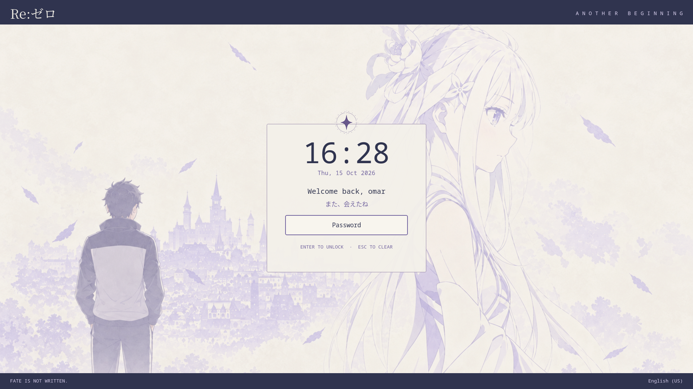

# Validation record

## Installed QuickShell locker — 2026-10-16

Validated with **QuickShell 0.3.1, Qt 6.11.2, Hyprland 0.56.2, and Hypridle 0.1.8** on Arch Linux. Tests install copied runtime files into a temporary home with spaces in its path and run a separate nested compositor. The author's active desktop configuration is not modified.

- **13 installer/launcher tests passed** across QuickShell and static Hyprlock: files-only staging, repeat enable, rollback, preservation of edits, idle conflict detection, invalid paths, symlink preflight, and releasing the launcher guard when a background descendant remains alive.
- **QML lint passed** for the production entry point, session controller, lock view, and Spotify panel.
- The staged Hyprland configuration, including the generated binding/source, passed `Hyprland --verify-config`.
- The installed QuickShell launcher acquired a real `ext-session-lock-v1` lock. Duplicate requests returned without creating a second locker.
- Empty input was ignored and Escape cleared input. A rejected real PAM fixture response kept the session locked. The accepted fixture response released all lock surfaces and exited successfully.
- A second monitor connected while locked received its own lock surface. Renderings were captured at 1920×1080, 1280×720, 1366×768, portrait 1080×1920, and 2560×1440 at 125% scale.
- The Spotify panel stayed hidden with no player and with an unrelated VLC identity. A real D-Bus MPRIS fixture registered as Spotify supplied track metadata; the panel's play/pause, next, and previous buttons sent the expected methods over D-Bus. Unsupported controls were disabled and disconnecting the player hid the panel.
- The actual Hypridle daemon launched the copied QuickShell locker on inactivity. Private login1 sleep and session-Lock signals also launched it. The sleep delay inhibitor released only after Hyprland confirmed the session locked.
- The rendered layout was visually inspected. Feathers and the ribbon remain separate moving layers over an ordinary still Image. No hair shader is shipped or loaded by the installed locker.


### Isolation and limits

PAM uses a deterministic helper mounted over `/etc/pam.d` **inside bubblewrap only**. No test PAM policy or test password is installed on the host. The production controller uses QuickShell's `PamContext`, authenticates the actual current user, and releases the lock only after `PamResult.Success`.

MPRIS and login1 run on a private D-Bus. Spotify transport has been verified against the real MPRIS interface using a fixture, not a signed-in Spotify account. The screenshot therefore labels the track artist as a test fixture. Cover art falls back to a music symbol when the player supplies no image. The fixture exports its interfaces before claiming the bus name, avoiding a service-startup race during discovery.

The checks do not physically suspend, reboot, or shut down the host, and do not authenticate using a real account password. Test the recipient's PAM policy, Spotify desktop client, GPU wake behavior, lock shortcut, and physical suspend/resume on that machine. Power buttons invoke real system actions only after confirmation and only when logind reports permission without an authentication challenge.

The nested test's additional developer packages are `bubblewrap grim wtype dbus python-gobject`. Repeat with:

```sh
python3 -m unittest discover -s tests -v
python3 tests/quickshell_smoke.py
```

The integration suite records screenshots, logs, and `results.json` under `validation/quickshell/`, excluded from Git. The production install has no test inspection endpoint, demo authentication, browser server, or playback fixture.

## Historical records

The records below describe earlier versions and their original test results.

## Full animated localhost preview — 2026-10-15

The complete QML design is now served at `http://localhost:8772/` by the independent `localhost/` project. It retains the original three-column interface and animations, with the central form adapted to preview unlocking the existing account.

- **30 native QML interaction checks passed**, including the read-only account, password validation, reveal/clear, mock unlock, all power confirmation/cancel paths, mute, and volume.
- **Browser checks passed** in Chromium: live noVNC connection, keyboard input, visible wrong-password and successful-unlock states, all three wallpaper selections, reset, and no JavaScript errors.
- The rendered scene was visually inspected, including the restored session panel, system metrics, CAVA, audio panel, power buttons, animated artwork, and footer.
- The transient localhost service successfully stopped and restarted. HTTP, WebSocket, and VNC listeners bind only to loopback. It is not enabled at boot.
- Active Hyprland and SDDM configuration hashes still match their values before this task. The extracted Hyprlock/Hypridle test tools and leftover test installation were removed.

This full preview uses mock authentication and simulated power actions. The following earlier tests describe the **separate, simpler Hyprlock version**, not a production backend for the animated QML scene.

## Earlier Hyprlock version

Validated on **2026-10-15** with Arch Linux, Hyprland **0.56.2**, Hyprlock **0.9.6**, and Hypridle **0.1.8**.

The author's installed Hyprland configuration and SDDM selection were unchanged, verified by before/after SHA-256 checks. No Re:Zero launcher or configuration was installed into the author's active desktop. All installed-theme tests used separate destinations.

## Passed

| Check | Evidence |
| --- | --- |
| Installer behavior | Six automated tests: files-only installation, repeat enable without duplicate startup, original-file restoration, preservation of unrelated and customized edits, existing-idle conflict detection, symlink/path refusal before writes |
| Persistent configuration | `Hyprland --verify-config --config <staged-home>/.config/hypr/hyprland.conf` returned `config ok`, including the generated source, binding, and `exec-once` command; test paths included spaces |
| Real session lock | The actual Hyprlock binary acquired `ext-session-lock-v1` in a separate nested Hyprland session |
| Password handling | Escape cleared input, empty Enter was ignored, wrong PAM fixture response remained locked, correct response authenticated and exited successfully |
| Repeated lock requests | A second launcher invocation returned successfully without starting another locker |
| Multiple monitors | A second headless monitor hotplugged while locked received its lock surface |
| Display layouts | Rendered at 1920×1080, 1280×720, 1366×768, portrait 1080×1920, and 2560×1440 at 125% scale |
| Idle lock | The actual Hypridle daemon launched the installed lock script when its test timeout expired; authentication then unlocked normally |
| Suspend integration | A simulated login1 `PrepareForSleep(true)` event on a private bus launched the locker; Hypridle released its delay inhibitor after the compositor reported the session locked |
| Session-lock integration | A simulated login1 session `Lock` signal on the same private bus triggered a second successful lock/unlock cycle |



[Password failure at 1280×720](password-failure.png) · [Portrait rendering](portrait.png)

## Test isolation and limits

`tests/smoke.py` runs real Hyprland, Hyprlock, and Hypridle processes. It creates its own temporary runtime directory, copied assets, configuration, and headless outputs. Its initial nested window is separate from the desktop running the test.

Authentication uses real PAM with a deterministic test helper mounted over `/etc/pam.d` **inside bubblewrap only**. This exercises Hyprlock's prompt, rejection, retry, and unlock paths without needing a real account password or modifying host PAM. The production installer copies only theme assets, configuration, and launchers; it does not install the test helper or test PAM policy.

The login1 service is a test double on a private D-Bus. The sleep test exercises Hypridle's real event handling and Wayland lock notification, but does not physically suspend the host. The idle timeout is shortened from 300 seconds to 2 seconds only in the disposable test copy.

The friend's own PAM configuration, actual password, GPU wake behavior, lid policy, physical suspend/resume, and reboot have **not** been tested remotely. Perform the recipient checks in the [installation guide](hyprlock-install.md#4-check-it-on-that-computer). Persistence is supplied by installed asset copies and a sourced `exec-once` entry that runs on each Hyprland login; there is no preview server or repository path required at runtime.

## Repeat the checks

```sh
python3 -m unittest discover -s tests -v
python3 tests/smoke.py
```

The second command additionally requires a running Wayland desktop and the developer dependencies listed in the README. It cleans up its child processes and temporary install automatically. Local logs, screenshots, and `results.json` are written under `validation/`, which is excluded from Git.
